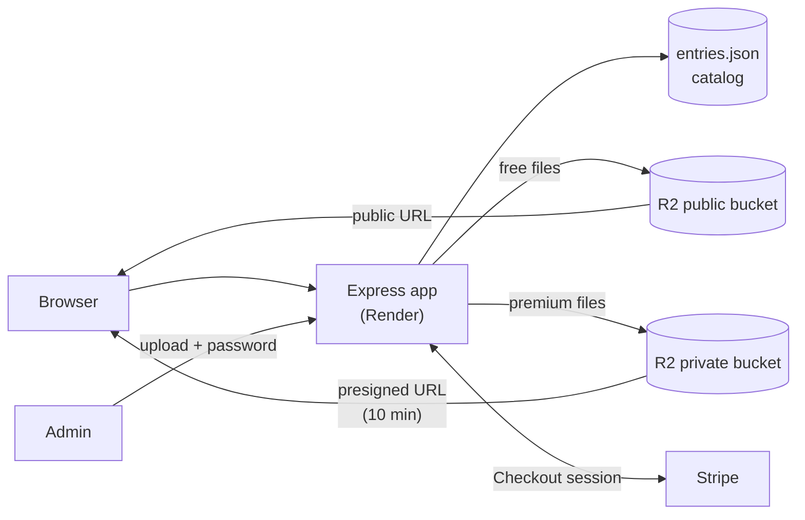

# T3ch Spec


An IT knowledge base I built and deployed: a public catalog of study guides, code and videos, with a password-protected upload page and paid content sold through Stripe. Deployed on Render with a custom domain, **t3chspec.com**.

Current content includes CompTIA Security+ study notes (fundamentals, threat actors, controls and cryptography, network/endpoint/cloud security, incident response), a subnetting guide and a Bash log-rotation script.

## Features

- **Catalog** of guides, code, videos and subjects, served from a JSON data file
- **Admin uploads** without touching code, protected by a password stored in an environment variable
- **Object storage** in Cloudflare R2 through the AWS S3 SDK, so files survive restarts and redeploys
- **Paid content** through Stripe Checkout, with downloads unlocked only after payment is verified
- **Video embeds** by link, so large video files never pass through the server

## Architecture



## Security design

- **Secrets stay out of the code.** All keys and the admin password come from environment variables. `.env` is git-ignored, and `.env.example` contains only placeholders.
- **Premium files are never exposed.** The API strips each premium entry's storage key before sending the catalog to the browser.
- **Downloads require verified payment.** The server retrieves the Stripe Checkout session and confirms it was paid *for that specific item* before issuing a download link.
- **Download links expire.** Premium files are served through presigned URLs that are valid for 10 minutes.
- **Uploads are constrained.** File names are sanitized and uploads are capped at 100 MB.

## Tech stack

| Layer | Technology |
|---|---|
| Server | Node.js, Express, Multer |
| Storage | Cloudflare R2 (S3-compatible) via `@aws-sdk/client-s3` |
| Payments | Stripe Checkout |
| Hosting | Render, custom domain via Namecheap DNS |
| Front end | HTML, CSS, vanilla JavaScript |

## Run locally

Requires [Node.js](https://nodejs.org) (LTS).

```bash
npm install
cp .env.example .env   # then fill in your own values
npm start
```

Open `http://localhost:3000`. The catalog is at `/` and uploads are at `/upload.html`.

## Configuration

| Variable | Purpose |
|---|---|
| `ADMIN_PASSWORD` | Password required to upload or delete entries |
| `PORT` | Local port (default `3000`) |
| `R2_ACCOUNT_ID`, `R2_ACCESS_KEY_ID`, `R2_SECRET_ACCESS_KEY` | Cloudflare R2 API credentials |
| `R2_BUCKET_NAME`, `R2_PUBLIC_URL` | Public bucket for free files and its public URL |
| `R2_PRIVATE_BUCKET_NAME` | Private bucket for paid files (no public access) |
| `STRIPE_SECRET_KEY` | Stripe secret key (`sk_test_...` for testing) |
| `BASE_URL` | Public site address, used for Stripe's return URLs |

<details>
<summary><b>Setting up Cloudflare R2</b></summary>

1. In the Cloudflare dashboard, go to **R2 Object Storage → Create bucket**.
2. Open the bucket → **Settings → Public access** and enable the `r2.dev` public URL. This is `R2_PUBLIC_URL`.
3. Create a second bucket for paid content and leave its public access **off**. This is `R2_PRIVATE_BUCKET_NAME`.
4. Go to **R2 → Manage API Tokens → Create API Token** with read/write access to both buckets, and copy the access key ID and secret.
5. Copy your **Account ID** from the dashboard.

</details>

<details>
<summary><b>Setting up Stripe</b></summary>

1. In the Stripe dashboard, switch to **Test mode**.
2. Go to **Developers → API keys** and copy the secret key into `STRIPE_SECRET_KEY`.
3. Test a purchase with card `4242 4242 4242 4242`, any future expiry date and any CVC.
4. When ready for real payments, swap in the `sk_live_...` key.

</details>

<details>
<summary><b>Deploying to Render with a custom domain</b></summary>

1. In Render, create a **Web Service** from this repository.
2. Set the build command to `npm install` and the start command to `npm start`.
3. Add every variable from the table above under **Environment**.
4. Under **Settings → Custom Domains**, add the domain and create the DNS records Render shows at your registrar.
5. Set `BASE_URL` to the final domain (for example `https://t3chspec.com`).

Render redeploys automatically on every push to `main`.

</details>

## Roadmap

- [ ] Move the catalog from `entries.json` to a database, since a server's local disk can reset on redeploy
- [ ] Replace the shared admin password with proper user authentication and rate limiting
- [ ] Confirm purchases with Stripe webhooks
